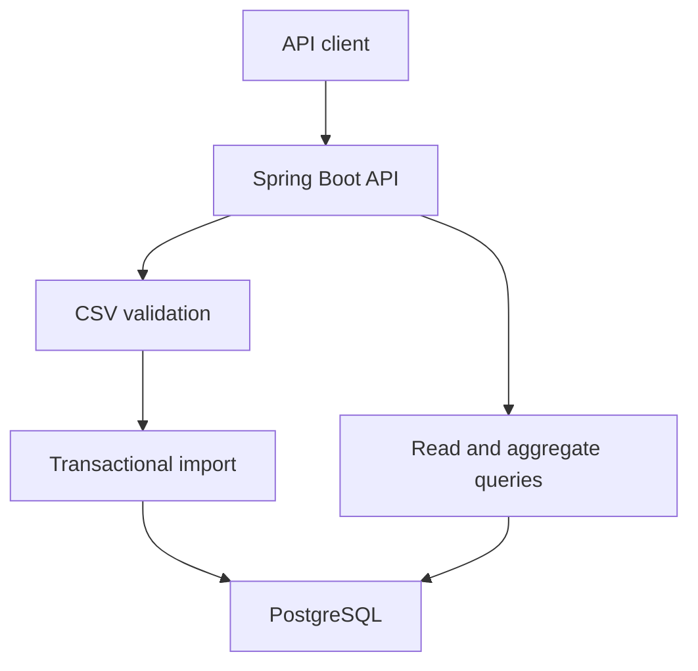

# DataDock

**A Java API that turns bounded CSV uploads into queryable sales data.**

DataDock validates an entire upload, imports it in a PostgreSQL transaction, and exposes
paginated sales and date-filtered revenue summaries. It is a backend portfolio project,
with Docker packaging, automated test workflows, and an Azure Container Apps deployment template.

**Status:** [CI passed](https://github.com/FuriousRec/datadock./actions/runs/34278137123): Maven build, unit and PostgreSQL integration tests,
Docker image build, Docker Compose startup, sample API smoke test, and Bicep compilation.
The packaged API verified **3 rows, 6 units, EUR 357.30** and duplicate rejection.
Azure resources have **not** been provisioned or deployed.
See [validation evidence](docs/validation.md).

## Features

- Strict UTF-8 CSV parsing, including quoted commas, escaped quotes, BOM and CRLF.
- Limits of 2 MiB and 10,000 sales per upload.
- Record-level validation; invalid files do not create partial imports.
- Database-enforced deduplication of byte-identical uploads, including concurrent requests.
- Exact decimal prices and EUR revenue calculations.
- SQL-backed aggregation, deterministic pagination and exact category filtering.
- API-key authentication with constant-time comparison and environment-provided secrets.
- Flyway schema migrations, health probes and structured operational log messages.
- Non-root container, local PostgreSQL Compose stack, GitHub Actions verification.
- Azure infrastructure template and manual OIDC deployment workflow.

## Architecture



The domain parser has no framework dependencies. Controllers handle HTTP, the service owns
transactions and parameterized SQL, and PostgreSQL enforces uniqueness and numeric constraints.
See [design decisions](docs/design.md) for failure modes and trade-offs.

## Run locally

Requires Docker with Docker Compose. Copy the demo configuration:

```bash
cp .env.example .env
docker compose up --build
```

PowerShell users can use `Copy-Item .env.example .env`. The API binds only to localhost;
the database is not exposed on a host port. The first build needs internet access.
The example credentials are deliberately for local use only.

Use the same API key from your local `.env` when calling the API:

```bash
export APP_API_KEY='local-demo-only-replace-with-random-32-character-key'
curl --fail -H "X-API-Key: $APP_API_KEY" \
  -F file=@examples/sales.csv http://localhost:8080/api/v1/imports
curl --fail -H "X-API-Key: $APP_API_KEY" \
  'http://localhost:8080/api/v1/analytics/summary?from=2026-09-01&to=2026-09-30'
```

Expected summary for the sample CSV: **3 rows, 6 units, EUR 357.30**.
Uploading the exact same bytes again returns **409 Conflict** and adds no rows.
Use `curl.exe` in Windows PowerShell if `curl` resolves to a PowerShell alias.

## API

Every `/api/v1/*` endpoint requires `X-API-Key`. Dates are inclusive ISO dates.

| Method | Route | Purpose |
|---|---|---|
| POST | /api/v1/imports | Multipart upload using the field `file`; returns import UUID, row count and SHA-256 |
| GET | /api/v1/sales | `from`, `to`, optional exact `category`, `page` (zero-based), `size` (1–100) |
| GET | /api/v1/analytics/summary | Row count, total units and EUR revenue for `from` / `to` |
| GET | /api/v1/analytics/categories | Revenue and units grouped by category |
| GET | /actuator/health | Public health status, with details hidden |
| GET | /actuator/health/readiness | Readiness includes database connectivity |

Errors use Problem Details responses: 400 invalid input, 401 missing/incorrect key,
409 duplicate file, 413 upload too large. Unexpected internal failures return 500
without application exception details. See [OpenAPI](docs/openapi.json).

## CSV contract

Exact header: `sold_at,sku,category,quantity,unit_price`.

| Column | Rule |
|---|---|
| sold_at | Valid YYYY-MM-DD, year 0001–9999 |
| sku | 1–80 characters after stripping surrounding whitespace; no control characters |
| category | Same label rules as SKU |
| quantity | Integer 1–10000 |
| unit_price | EUR, 0–999999.99, at most two decimal places; no exponent notation |

The importer accepts free-of-charge items. It rejects empty files, header-only files,
blank records, malformed UTF-8, NULs, malformed quoting and inconsistent column counts.
Quoting is parsed across record separators, but multiline SKU/category values are rejected
by label validation. Prices use a decimal dot. All data is assumed to be EUR.

Deduplication is **file-byte based**, not business-event based. A reformatted file or
overlapping exports can double-count sales. Each row is treated as a separate sale;
duplicate rows inside one file are allowed. This limitation is intentional and documented.

## Test

With Java 17 and Maven 3.9+, unit checks run without Docker:

```bash
mvn test
```

Full verification requires Docker and uses a real PostgreSQL Testcontainer:

```bash
mvn verify
```

It covers HTTP authentication, CSV import, date/category filtering, invalid input, duplicate uploads,
and simultaneous identical uploads. CI runs verification before building the image.

The same 33 domain checks can also run without Maven or downloaded dependencies:

```bash
sh scripts/test-core.sh
```

See [validation status](docs/validation.md) for the checks actually executed.

## Azure

See the [deployment runbook](docs/azure.md). The supplied Bicep template configures a
container app, managed identity for image pulls, health probes, and logging. PostgreSQL
and the registry are provisioned separately. The workflow is manual and must pass
`mvn verify` before updating the app.

Cloud resources may incur charges, including PostgreSQL and logs when the API scales to zero.
Nothing in this repository automatically creates resources on push.

## Development

- [Design and trade-offs](docs/design.md)
- [Deployment runbook](docs/azure.md)
- [Interview preparation](docs/interview.md)
- [Validation evidence](docs/validation.md)

Stop local services with `docker compose down`. The named volume retains data.
For a deliberate local reset only, `docker compose down -v` deletes that volume.

## License

[MIT](LICENSE).
